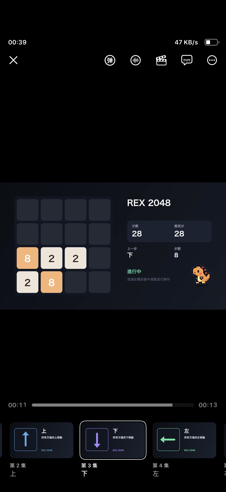

# Rex 2048



在 Rex 播放器里用选集玩 2048。棋盘由服务端渲染成 720p30 视频，Rex 只负责播放。

## 怎么玩

在播放器里打开选集：

| 选集 | 操作 |
| --- | --- |
| 1 | 开局 |
| 2 | 上 |
| 3 | 下 |
| 4 | 左 |
| 5 | 右 |
| 6 | 重复 |
| 7 | 撤销 |

第一次打开会创建棋局，退出后再打开会继续。只有第 1 集会重新开局。

## 启动

需要 Node.js 20+ 和 FFmpeg。

```bash
npm install
npm run server
```

默认监听 `0.0.0.0:18081`，同一局域网可以直接打开：

```text
http://<这台电脑的局域网IP>:18081/
```

只想本机访问：

```bash
API_BIND=127.0.0.1 npm run server
```

原生服务会自动读取项目根目录的 `.env`；已经存在的环境变量优先。

## Docker

```bash
cp .env.example .env
docker compose up -d --build
```

默认只开放 `18081`，`18080`（HTTP-FLV）和 `1935`（RTMP）留在容器内部。建议在 `.env` 里设置 `ADMIN_TOKEN`；不设置时调试页和 session 列表不可用。

## 导入 Rex

打开首页，点“导入到 Rex”。如果浏览器没有唤起 Rex，复制模块地址：

```text
http://<这台电脑的局域网IP>:18081/module/rex-2048.js
```

在 Rex 的「设置 → 模块 → 导入的模块 → 通过链接添加」里粘贴。通过服务端地址下载的模块，会自动把下载地址的 origin 作为默认服务端地址；只有手动导入本地文件时才需要自己填写。

修改模块代码后运行 `npm run build`。构建产物是 `dist/index.js`，首页会以 `rex-2048.js` 提供。

## 常用设置

- `ADMIN_TOKEN`：管理员 token，保护 `/debug` 和 session 列表
- `MAX_ACTIVE_STREAMS`：最多同时几条视频流，默认 16
- `MAX_SESSIONS`：最多保存几个棋局，默认 128；满了会拒绝新会话，不会删除其他存档
- `STREAM_ENCODER`：`auto`、`libx264`、`h264_videotoolbox`、`h264_nvenc`、`h264_vaapi`

VAAPI 容器还需要让 `node` 用户能访问 `/dev/dri`。`compose.vaapi.yaml` 默认补 `RENDER_GID=109`、`VIDEO_GID=44`；如果宿主机 GID 不同，用 `stat -c '%g' /dev/dri/renderD128` 和 `stat -c '%g' /dev/dri/card0` 查到后写进 `.env`。

## 测试

```bash
npm test
npm run test:stream
```

`npm test` 跑单元和接口测试；`npm run test:stream` 会真实启动 FFmpeg 和 NMS 检查视频流。

## 说明

- 棋局保存在 `.data/sessions.json`，服务重启后自动恢复。
- 每个 Rex 安装有独立 token，多人互不影响。
- 默认 1280×720、30fps、2Mbps；有硬件编码时优先使用硬件。
- Docker 环境默认关闭 Rex 本机播放进度清理；如果遇到从旧进度续播，在 Rex 播放设置里开启“每次从头播放”。
